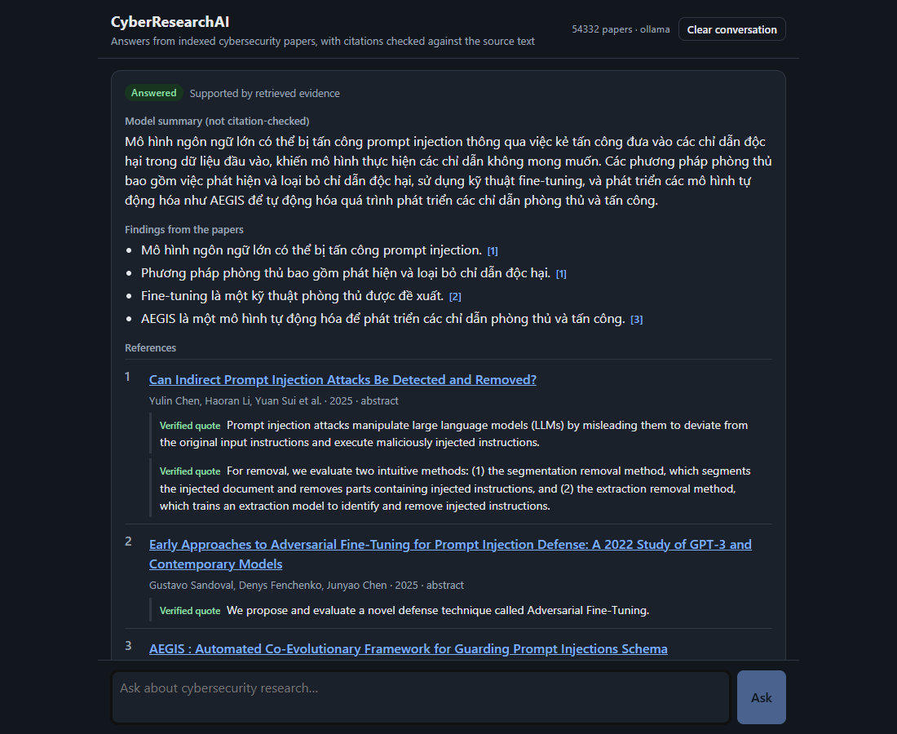
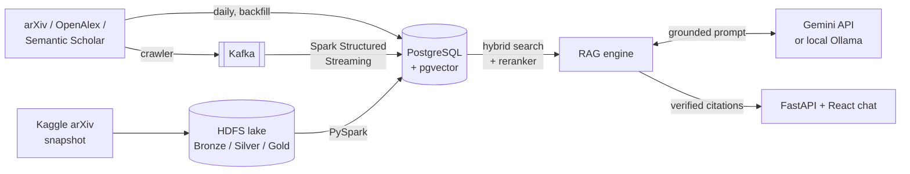

<div align="center">

# CyberResearchAI

**Ask questions about cybersecurity research and get answers that cite the papers, with every quote checked against the source text.**

[](https://github.com/leminh05/CyberResearchAI/actions/workflows/ci.yml)




</div>

## At a glance

| | |
|---|---|
| **Corpus** | 54,301 cybersecurity papers and 74,005 embedded chunks in the large corpus; 377 papers with PDF text in the evaluated one |
| **Sources** | arXiv, OpenAlex and Semantic Scholar APIs, plus the Kaggle arXiv snapshot through an HDFS lake |
| **Big Data path** | PySpark Bronze / Silver / Gold on HDFS, and Kafka with Spark Structured Streaming into the chatbot's database |
| **Search** | Hybrid vector + full-text search, a cross-encoder reranker, at most 3 chunks per paper |
| **Answers** | Gemini API (about 30 s) or local Ollama (2-3 min), picked in the chat header; a citation is shown only if its quote is found word for word in the cited chunk |
| **Measured** | Large corpus: MRR 0.935, 0 unsupported claims shown, 7 of 8 unanswerable questions declined. Silver labels from AI judges; limits in the [report](docs/evaluation_report.md) |



**Contents:** [Quickstart](#quickstart-docker) · [Setup](#setup-windows-powershell) ·
[Data ingestion](#data-ingestion-phase-1) · [Processing](#pdf-processing-and-embeddings-phase-2) ·
[RAG chatbot](#rag-chatbot-phase-3) · [Evaluation](#evaluation-phase-4) · [HDFS lake](#hdfs-data-lake) ·
[Streaming](#streaming-ingestion) · [Web app](#web-application-phase-5) · [Tests](#tests) ·
[Project layout](#project-layout)

## Status

| Phase | Scope | Status |
|---|---|---|
| 0 | Repository audit, environment, configuration | Done |
| 1 | Academic data ingestion (arXiv, OpenAlex, Semantic Scholar) | Done |
| 2 | PDF processing, chunking, embeddings, pgvector, PySpark + benchmark | Done |
| 3 | RAG engine with verified citations + terminal chatbot | Done |
| 4 | System evaluation: data, retrieval, answers, performance | Done (see [docs/evaluation_report.md](docs/evaluation_report.md)) |
| 5 | Web application: FastAPI backend + React chat with verifiable citations | Done |

## Quickstart (Docker)

From an empty database to a working chatbot with a small sample of recent papers. Needs Docker
Desktop with Compose v2, and [Ollama](https://ollama.com) running on this machine for the answers.

```powershell
ollama pull qwen2.5:7b
Copy-Item .env.example .env       # then set POSTGRES_PASSWORD, and the same value in DATABASE_URL
docker compose up -d --wait
docker compose --profile app build app
docker compose run --rm app init-db
docker compose run --rm app daily --sources arxiv --max-records 50
docker compose run --rm app process --no-download
docker compose --profile web up -d --build --wait
```

Open http://127.0.0.1:8000. The first run downloads the images and the embedding model. An answer
takes 1-3 minutes on a small GPU. Stop with `docker compose --profile web down`; data stays in the
volumes.

This sample holds only recently published papers with abstracts, so it shows that the system works,
not the quality measured in the [evaluation report](docs/evaluation_report.md). More data: PDF text
with `process` ([Phase 2](#pdf-processing-and-embeddings-phase-2)), a date range with `backfill`
([Phase 1](#data-ingestion-phase-1)), and about 54,000 papers from the arXiv snapshot
([large corpus](#large-corpus-for-the-chatbot)).

## Setup (Windows PowerShell)

```powershell
# 1. Create the virtual environment (Python 3.11) - skip if .venv already exists
py -3.11 -m venv .venv

# 2. Activate it. If scripts are blocked, run once:
#    Set-ExecutionPolicy -Scope CurrentUser RemoteSigned
.\.venv\Scripts\Activate.ps1

# 3. Install dependencies (runtime + test tools)
python -m pip install -r requirements-dev.txt

# 4. Create your local secrets file and fill in values (never commit .env)
Copy-Item .env.example .env

# 5. Verify the environment and configuration
python main.py check

# 6. Run the tests
python -m pytest
```

## Docker (PostgreSQL + application)

Needs Docker Desktop with Compose v2. To keep images off drive C, set
*Settings → Resources → Advanced → Disk image location* (for example `D:\Docker`)
before the first pull.

```powershell
Copy-Item .env.example .env       # then set POSTGRES_PASSWORD and the same value in DATABASE_URL
docker compose up -d              # PostgreSQL 16 + pgvector 0.8.0 on 127.0.0.1:5432 (volume "pgdata")
python main.py check              # the host app now uses DATABASE_URL from .env

# Optional: run the application itself in a container (profile "app")
docker compose --profile app build app
docker compose run --rm app check
docker compose run --rm app rag-eval --retrieval-only
docker compose run --rm app chat --provider ollama   # Ollama stays on the host (GPU)

docker compose down               # stop; data stays in the pgdata volume
```

| Item | Choice | Why |
|---|---|---|
| Image | `pgvector/pgvector:0.8.0-pg16` (pinned) | Same PostgreSQL 16 as before, newer pgvector than the embedded 0.6.2 |
| Port | `127.0.0.1:5432` only | The database is not reachable from the network |
| Host name in `DATABASE_URL` | `127.0.0.1`, **not** `localhost` | On Windows `localhost` resolves to IPv6 `::1` first; the connection then stalls (measured: 8 s with a timeout, a hang without) |
| App image | `python:3.11-slim` + Java 17 + CPU-only PyTorch, non-root user | PySpark runs with Java 17 inside the image regardless of the host's Java 8 |
| Ollama | Host, reached at `host.docker.internal:11434` | GPU access is simpler outside Docker on Windows |

**Moving existing data.** `scripts/migrate_embedded_to_docker.py` copies the
embedded development database (`data/pgdata`) into the Docker database with the
`pg_dump`/`pg_restore` that ship with `pgserver`, refuses to overwrite a
non-empty target, and compares row counts per table. Run on 2026-11-02: 377
papers, 381 source records, 7,691 chunks - identical counts on both sides.

**Tests against Docker:** set `TEST_DATABASE_URL` to the same URL as
`DATABASE_URL`; every test runs in its own temporary schema and drops it.

## Data ingestion (Phase 1)

```powershell
python main.py init-db                                    # create tables (idempotent)
python main.py daily                                      # incremental: recent papers
python main.py daily --sources arxiv openalex --max-records 50
python main.py backfill --start 2023-01-01 --end 2024-12-31   # historical range
python main.py status                                     # counts, checkpoints, last logs
```

### How it works

```
arXiv (Atom XML) ─┐
OpenAlex (JSON)  ─┼─> HttpClient ──> normalize ──> PaperRecord ──> dedup ──> PostgreSQL
Semantic Scholar ─┘   timeout, retry,   DOI, arXiv ID,   common      ID / title+year
                      backoff, rate     title, dates     schema      matching
                      limit
```

| Concern | Implementation |
|---|---|
| Separate API clients | `src/cyberresearch/ingestion/clients/{arxiv,openalex,semantic_scholar}.py`, one shared `fetch_page()` interface |
| Common schema | `PaperRecord` in `ingestion/schema.py`; original payload kept in `raw` |
| Timeouts, retries, backoff | `ingestion/http.py`: retries timeouts, connection errors, 429 and 5xx with `base * 2^attempt` + jitter, honours `Retry-After`; other 4xx fail fast |
| Rate limits | Minimum interval per source (`config/settings.yaml`): arXiv 3 s, OpenAlex 0.2 s, Semantic Scholar 1.1 s with key / 3 s without |
| Deduplication | `ingestion/dedup.py`, priority: arXiv ID → DOI → Semantic Scholar ID → OpenAlex ID → normalized title + year (rejected if DOIs/arXiv IDs conflict). Missing fields are filled from later sources, never overwritten |
| Missing metadata | Every field except `source`/`source_id` is optional; items with neither a title nor an identifier are skipped and counted |
| No needless reprocessing | `paper_sources.content_hash`: an identical record is only marked as seen (`unchanged`) |
| Checkpoint & resume | `ingestion_checkpoints` stores the API cursor after every page, in the same transaction as that page's records |
| Daily vs backfill | `daily`: window = last completed end − 1 overlap day → today. `backfill`: range split into 12-month windows (newest first); completed windows are skipped |
| Logs | `ingestion_logs` table (one row per source/topic/window) + JSON-lines file `logs/ingestion.log` with API keys redacted |

### Database tables

| Table | One row per | Key columns |
|---|---|---|
| `papers` | unique paper | `doi`, `arxiv_id`, `s2_paper_id`, `openalex_id` (unique), `normalized_title`+`year`, `topics[]` |
| `paper_sources` | (source, source_id) | `paper_id` FK, `raw` JSONB, `content_hash`, first/last seen |
| `ingestion_logs` | run × source × topic × window | status, fetched / inserted / merged / updated / unchanged / failed |
| `ingestion_checkpoints` | mode × source × topic × window | `cursor`, `status` |

PDFs are **not** downloaded in this phase.

### Source notes (verified 2026-11)

- **OpenAlex** requires an API key for cursor paging beyond the first page
  (HTTP 401 otherwise). Without `OPENALEX_API_KEY` the client uses page-number
  paging, limited by OpenAlex to the first 10,000 results per query.
- **Semantic Scholar** works without a key, but the shared pool is often
  throttled (HTTP 429, retried automatically). A free key is recommended.
- **arXiv** asks for at most one request every 3 seconds; large backfills are
  therefore slow by design.

## PDF processing and embeddings (Phase 2)

```powershell
python main.py process --limit 40          # access check -> download -> extract -> chunk -> embed -> store
python main.py process --no-download       # abstracts only, no PDF downloads
python main.py process --reprocess-pdfs    # re-chunk PDFs already on disk (after rule changes)
python main.py search "intrusion detection with graph neural networks" -k 5
```

```
papers ──> access policy ──> polite downloader ──> PyMuPDF ──> cleaning ──> sections ──> chunks ──> embeddings ──> pgvector
           (license check)   (robots.txt,          (blocks     (headers,    (numbered    (page per   (all-MiniLM    (HNSW,
                              crawl-delay,          per page)   footers,     headings)    word)       -L6-v2, 384d)   cosine)
                              %PDF check)                       hyphens)
```

### Legal access policy (`processing/access.py`)

| Case | Decision |
|---|---|
| Paper has an arXiv ID | Download from `arxiv.org/pdf/<id>` (arXiv's robots.txt allows `/pdf/` with a **15 s crawl delay**; `export.arxiv.org` disallows it) |
| OpenAlex / Semantic Scholar PDF with a Creative Commons or public-domain license | Download |
| License missing, `other-oa`, or restrictive | **Not downloaded**; the abstract from the API is used instead |
| No PDF URL | Abstract only |

The downloader also honours `robots.txt` (a site that disallows us or whose
robots.txt is unavailable is skipped), rate-limits each host, rejects files
larger than 30 MB, and checks the `%PDF-` signature (many "PDF" links are HTML
landing pages). PDFs are stored in `data/pdfs/` (git-ignored, never committed).

### Text processing (`processing/`)

| Step | Module | What it does |
|---|---|---|
| Extract | `extract.py` | PyMuPDF text blocks per page; rejects non-PDF, encrypted and scanned (no text layer) files |
| Clean | `cleaning.py` | Removes running headers/footers (blocks repeated on ≥ 50% of pages), page numbers, arXiv margin stamps; fixes ligatures and hyphenation |
| Sections | `sections.py` | Detects `1 Introduction`, `1\nIntroduction` (LaTeX layout), `IV. EXPERIMENTS`, `References`; a numbered heading is accepted only if its number follows the previous one, which rejects list items and algorithm steps |
| Chunk | `chunking.py` | ~220 words with 40 words overlap, never across sections, cut at sentence ends; every word carries its page, so `page_start`/`page_end` are exact; references are excluded |
| Embed | `embeddings.py` | `sentence-transformers/all-MiniLM-L6-v2`, 384 dimensions, L2-normalized |
| Store | `store.py` | `pdf_documents` (status per paper) and `paper_chunks` (text, section, pages, URL, `vector(384)`, HNSW index) |

A database `CHECK` constraint makes it impossible to store a PDF chunk without
a page number. Abstract-only chunks are stored with `content_source =
'abstract'` and no page, so later phases can cite them as "abstract".

### PySpark (`bigdata/`)

| Job | Spark operations |
|---|---|
| Metadata normalization | `regexp_replace`, `lower`, `substring`, `cast`, `when` - built-in JVM functions, no Python UDF |
| Data filtering | `filter` with null checks and year range |
| Deduplication | priority key with `coalesce`; `Window.partitionBy(key).orderBy(completeness, source rank)` + `row_number() == 1` |
| Data quality checks | one `agg` pass for null rates, counts before/after each step, `groupBy(source).count()` |
| Batch processing | `groupBy(paper_id)` + `collect_list` of pages, then the same Python cleaning/section/chunking code in a UDF, `explode` to one row per chunk |

`bigdata/python_baseline.py` implements exactly the same rules in plain
Python; tests assert that both produce identical results. Spark runs in
**local mode** (`local[*]`: one JVM on this machine) - see the benchmark
section for what this does and does not show.

### Benchmark: plain Python vs PySpark

```powershell
python main.py benchmark --sizes 1000 10000 100000 300000 --repeats 3
```

Same input file, same rules, identical output for every size (checked
record by record). Full report: [docs/benchmark_results.md](docs/benchmark_results.md).
Measured 2026-11-02 on this laptop (12 logical CPUs, Windows 11, Java 8,
Spark 3.5.9 `local[*]`, driver memory 2 GB):

| Records | File | Python | Spark | Spark / Python | Python peak heap | Spark JVM heap used |
|---:|---:|---:|---:|---:|---:|---:|
| 1,000 | 1.7 MB | 0.08 s | 0.87 s | 10.4x slower | 4 MB | 437 MB |
| 10,000 | 17.7 MB | 0.82 s | 1.10 s | 1.3x slower | 40 MB | 212 MB |
| 100,000 | 177 MB | 8.99 s | 4.17 s | 2.2x faster | 397 MB | 505 MB |
| 300,000 | 532 MB | 26.74 s | 8.79 s | 3.0x faster | 1,195 MB | 849 MB |

Spark session startup: **4.2 s**, paid once per process and *not* included above.

What this shows:

- **Overhead dominates small data.** Planning a job, scheduling tasks and
  starting the JVM-side work costs ~0.8 s even for 1,000 records; with the
  4.2 s startup, plain Python wins easily below ~10,000 records. Our real
  corpus (381 records today) is far below that point.
- **Spark wins on larger files because it uses all 12 cores.** Python runs
  on one core; Spark splits the file into partitions processed in parallel.
  Part of the gain is simply parallelism - a `multiprocessing` version of
  the Python code would narrow the gap.
- **Memory grows differently.** The Python version holds every record in a
  list (heap grows linearly: ~4 KB per record, 1.2 GB at 300k). Spark streams
  partitions and spills to disk if needed; its JVM heap figure is
  approximate (it depends on garbage collection) and includes Spark's own
  overhead, which is why it is large for small inputs.

What this does **not** show:

- **No cluster performance.** Everything ran on one machine. Network shuffle,
  data locality and executor failures - the main costs and benefits of a
  real cluster - are not measured. These numbers must not be presented as
  distributed-scaling results.
- **Synthetic scale-up.** Only 381 records are real; larger sizes are copies
  with new identifiers and ~20% injected duplicates (`bigdata/dataset.py`).
- **Single-key deduplication.** Both implementations use one dedup key per
  record. Linking records through different identifiers (A~B by DOI, B~C by
  arXiv ID) needs connected components (e.g. GraphFrames), which is handled
  by the database stage instead.
- **Python UDF cost.** The batch-chunking job reuses Python code in a UDF,
  which serializes data between the JVM and Python workers; built-in Spark
  functions (used for metadata) avoid that cost.

## RAG chatbot (Phase 3)

Three interchangeable answer generators, selected with `rag.provider` in
`config/settings.yaml` or `--provider` on the command line:

| Provider | Needs | Notes |
|---|---|---|
| `claude` (default) | `ANTHROPIC_API_KEY` in `.env` (billed per use) | `claude-opus-5-5`, structured output, refusal fallback |
| `ollama` | [Ollama](https://ollama.com) running locally + `ollama pull qwen2.5:7b` | Free, offline. On this laptop (GTX 1650 Ti 4 GB, 32 GB RAM) about 2-3 min per answer; less accurate |
| `gemini` | `GEMINI_API_KEY` in `.env` ([free tier](https://aistudio.google.com/apikey)) | `gemini-2.5-flash`, about 40 s per answer on the website. Questions and excerpts are sent to Google |

Prompt, JSON schema and citation validation are the same for all three, so a
weaker local model cannot slip unverified citations through - its answers are
downgraded instead. Ollama's context window is set explicitly
(`rag.ollama.num_ctx`), and a prompt that fills it is rejected, because Ollama
otherwise silently cuts long prompts. `GEMINI_API_KEY` may hold several keys
separated by commas: on a rate limit the next key is used, and the chatbot waits
only when every key is limited (and fails at once on a daily limit). The answer
evaluation in `docs/evaluation_report.md` was run with Ollama, not Gemini. To keep models off drive C, set the user
environment variable `OLLAMA_MODELS` (for example `D:\Ollama\models`) and
restart Ollama before pulling.

```powershell
python main.py chat --provider ollama                  # free local model
python main.py chat --provider gemini                  # hosted, free tier
python main.py chat                                    # interactive chatbot (Claude)
python main.py chat --year-min 2025 --topic intrusion_detection
python main.py ask "How are graph neural networks used for intrusion detection?"
python main.py ask "..." --json                        # validated answer + evidence as JSON
python main.py rag-eval --retrieval-only               # test questions, no Claude calls
python main.py rag-eval                                # test questions, full pipeline
```

Chat commands: `/citations` (references with the verified quotes), `/evidence`
(all retrieved chunks), `/filter year>=2024 | year<=Y | topic=<key> |
source=pdf|abstract | clear`, `/new` (forget the conversation), `/help`, `/exit`.

```
question ──> embed (same model as chunks) ──> pgvector search + SQL filters ──> per-paper cap ──> top-K evidence
                                                                                        │
             best similarity < min_similarity ──> "insufficient evidence" (Claude not called)
                                                                                        │
Claude (claude-opus-5-5, structured JSON) <── evidence E1..Ek + question + previous turns
   │
   └─> claims + citations {evidence_id, verbatim quote} ──> validation ──> answer + references from the database
```

| Concern | Implementation (`src/cyberresearch/rag/`) |
|---|---|
| Same embedding model | `retrieval.py` refuses to run if `paper_chunks.embedding_model` differs from the query embedder |
| Metadata filtering | year range, topic, `pdf`/`abstract`, excluded sections (default: `Front Matter`), paper ids - all in SQL |
| Top-K selection | 40 nearest candidates → at most 3 chunks per paper → best 8 |
| Reranking | Cross-encoder `ms-marco-MiniLM-L-6-v2` on the CPU over the merged candidates, before the per-paper cap; `rag.rerank` in `config/settings.yaml` (see below) |
| Grounded prompt | `prompts.py`: evidence in `<evidence id="E3" ...>` blocks with year, section, page and similarity; no URLs or DOIs are shown to Claude; text inside excerpts is treated as data (prompt-injection guard) |
| Structured output | `output_config.format` JSON schema: `answer_status`, `summary`, `claims[{statement, kind: evidence\|interpretation, citations[{evidence_id, quote}]}]`, `ambiguity_note`, `limitations`, `follow_up_suggestions` |
| Citation validation | `citations.py`: the evidence id must be one retrieved for this question **and** the quote (≥ 5 words) must occur in that chunk's stored text. Unverified citations are dropped; an evidence claim with none left is removed and the answer is downgraded |
| Citation format | Built from the database, never from model text: title, authors, year, DOI → arXiv → landing-page URL, section and page (or "abstract"), evidence id → `paper_id`, `chunk_id`, chunk number |
| Arbitrary URLs | Any URL, DOI or arXiv id written by Claude is removed and reported |
| Insufficient evidence | Two layers: a similarity gate before Claude, and Claude's own `insufficient_evidence` / `partial` / `out_of_scope` status; evidence claims are never shown with those statuses |
| Evidence vs interpretation | Separate sections in the answer: "Findings from the papers" (cited) and "Interpretation" (assistant's reasoning) |
| Follow-ups | The previous question is added to the retrieval query; the last 3 turns are given to Claude as context, marked "not evidence" |
| Refusals | `fallbacks: "default"` (beta `server-side-fallback-2026-07-01`) re-runs a declined request on the model Anthropic recommends for that category; a final refusal is shown as "declined", never as an answer |

**Test questions** (`config/rag_test_questions.yaml`): 15 questions on network
security, intrusion detection and AI for cybersecurity, in four groups -
sufficient evidence, weak evidence, outside the corpus, ambiguous terms (one is
in Vietnamese). Latest run with the local model: **15/15 passed**, see
[docs/rag_eval_results.md](docs/rag_eval_results.md). The Claude API path is
covered by unit tests with a fake client; it has not been run live yet.

**Why a reranker.** It was measured when the corpus grew to 54,301 papers: MRR rose
from 0.835 to 0.935, at about 2 s per question on the CPU and one more model download.
It changes only the order, so the similarity gate still uses cosine scores. On the
377-paper corpus it changed little. Section 11 of the
[evaluation report](docs/evaluation_report.md) has the numbers and their limits,
including one more unanswerable question that got a partial answer.

## Evaluation (Phase 4)

```powershell
python main.py evaluate                                  # data quality, retrieval, performance (~2 min)
python main.py evaluate --part answers --provider ollama # answer quality, calls the LLM (~45 min locally)
python main.py evaluate --part retrieval --ids gnn-ids   # one question
python scripts/build_judgment_pool.py > data/eval/pool.md  # candidates for relevance judging
```

- Dataset: [config/eval/golden_set.yaml](config/eval/golden_set.yaml) -
  30 answerable questions with judged relevant papers (stable DOI/arXiv keys)
  and key points, 10 unanswerable ones (4 off-domain, 6 in-domain "hard").
- Results: JSON per part in `docs/evaluation/` (regenerated by the command;
  the first evaluation is kept in `docs/evaluation/before_quality_fixes/`);
  methods, numbers and weaknesses in
  [docs/evaluation_report.md](docs/evaluation_report.md).

## HDFS data lake

A small HDFS cluster for the Spark data lake: one NameNode and two DataNodes, with
every block stored twice. All three run on this machine, so it demonstrates HDFS
storage and replication, not cluster speed or protection against a machine failing.

```powershell
docker compose --profile hdfs up -d                        # NameNode UI: http://127.0.0.1:9870
docker compose --profile app --profile hdfs build app      # once, and after code changes
docker compose --profile app --profile hdfs run --rm app hdfs-check   # Spark writes, reads back and compares
docker compose --profile hdfs stop                         # data stays in the hdfs_* volumes
```

Run Spark jobs that use HDFS in the `app` container: the host cannot resolve the
`namenode` and `datanode` names, and the image has the Java version Spark needs.
The cluster has no security and publishes only its web UI, on localhost.

### arXiv lake (Bronze / Silver / Gold)

Put the Kaggle arXiv snapshot at `data/raw/arxiv/arxiv-metadata-oai-snapshot.json`, then:

```powershell
docker compose --profile app --profile hdfs run --rm app lake
```

Bronze keeps every raw record, Silver keeps cleaned and de-duplicated `cs.CR` papers
plus the rejected ids, and Gold holds statistics by year and by related category. The
report is saved to `data/eval/lake_report.json`; the measured run is in
[docs/bigdata/lake_report.json](docs/bigdata/lake_report.json).

### Large corpus for the chatbot

About 54,000 cybersecurity papers in their own database, `cyberresearch_large`, which
starts as a copy of the main one. The application uses it only when `APP_DB` is set:

```powershell
$env:APP_DB = "cyberresearch_large"
docker compose --profile app --profile hdfs run --rm app lake-load              # Silver papers into PostgreSQL
docker compose --profile app --profile hdfs run --rm app process --no-download  # embeddings for the abstracts
Remove-Item Env:APP_DB
```

To serve this corpus from the website, set `WEB_DB=cyberresearch_large` in `.env` and run
`docker compose --profile web up -d`. Only the website uses it: crawling, processing and
`main.py evaluate` stay on the main database, whose labels they rely on. Streaming follows
the website (see [Streaming ingestion](#streaming-ingestion)). Without that database, leave
`WEB_DB` empty.

The new papers have abstracts only, so answers from them cite no page numbers. Section 11
of the evaluation report has the measured effect on answers.

## Streaming ingestion

New papers flow through Kafka without a manual command:

```text
crawler (stream-produce) -> Kafka topic papers.raw -> Spark Structured Streaming (stream-consume)
                                                        |-> raw messages on HDFS (Bronze)
                                                        |-> bad messages on HDFS (rejected)
                                                        |-> PostgreSQL: papers, abstract chunks, embeddings
```

```powershell
docker compose --profile streaming up -d --build     # Kafka, HDFS, crawler (hourly) and streaming job
docker compose --profile streaming logs -f stream-consumer   # one JSON line per micro-batch
docker compose --profile streaming stop              # data stays in the volumes
```

For a short demonstration, run each side once:

```powershell
docker compose --profile hdfs --profile streaming up -d kafka namenode datanode1 datanode2
docker compose --profile app run --rm app stream-produce --sources arxiv --max-records 10
docker compose --profile app run --rm app stream-consume --once
```

`--max-records` applies to each source and topic and is checked after each page, so one run
can send up to a page more (100 records for arXiv and OpenAlex). Cutting a page short would
make the saved cursor skip its remaining records.

Streamed papers go to the database the website serves, so the chatbot can answer from them
as soon as a batch ends, with no restart. `STREAM_DB` in `.env` sends them elsewhere. With
`WEB_DB` empty that is the main database, so streaming on a machine that holds the Phase 4
corpus changes what `main.py evaluate` measures: set `STREAM_DB` to another name there. Only
abstracts are embedded here; PDFs stay a job for `process`.

Delivery is at least once: a batch is replayed after a crash, and the deduplicating
upsert makes the replay harmless. Kafka has one broker, no authentication and no
published port. This runs on one machine, so it shows the mechanism, not cluster
scale. Sources publish in daily batches, so batch ingestion would also serve this
corpus; streaming adds automation rather than fresher answers.

## Web application (Phase 5)

A thin FastAPI layer (`src/cyberresearch/web/`) over the same `RAGEngine` as the
terminal chatbot, and a React chat (`frontend/`). Retrieval, generation and
citation validation are not duplicated: the website only displays what the
backend validated.

### Run locally

Needs the database running (`docker compose up -d`) and Node.js 20+ for the build.

```powershell
cd frontend
npm ci
npm run build                            # creates frontend/dist, served by FastAPI
cd ..
python main.py serve --provider ollama   # or gemini / claude with its key in .env
```

Open http://127.0.0.1:8000. On this laptop an Ollama answer takes 1-3 minutes and a
Gemini answer 20-40 s; off-topic questions are declined at once.

**Choosing the model:** the `--provider` model is the default, and the header offers
every other model that can run: Ollama always, Gemini and Claude only when their key
is in `.env`. The choice is sent with each question, so it can change in the middle
of a conversation; reloading the page goes back to the default.

**Frontend development** (hot reload): keep `python main.py serve` running, run
`npm run dev` in `frontend/` and open http://localhost:5173. Vite forwards `/api`
to the backend, so the API needs no CORS.

### API

| Endpoint | Purpose |
|---|---|
| `POST /api/chat` | Body `{"question": "...", "conversation_id": null}`. Returns status, summary, claims with verified citations, references and metadata |
| `GET /api/health` | Database, model and corpus status. HTTP 503 if the database is down |
| `DELETE /api/conversations/{id}` | Forget the follow-up context of a conversation |
| `GET /docs` | Interactive API documentation |

A reference is built from the database row behind the citation, never from model
output, and each quote was found in the cited chunk by the existing validator.
Errors have the form `{"error": {"code": "...", "message": "..."}}`:

| HTTP | Code | When |
|---|---|---|
| 404 | `conversation_not_found` | Conversation expired, or the server restarted |
| 409 | `conversation_busy` | That conversation is still answering |
| 413 | `body_too_large` | Request body over 64 KB |
| 422 | `invalid_request` | Empty question, over 2,000 characters, or unknown fields |
| 429 | `rate_limited` | Over the per-client limit; see the `Retry-After` header |
| 502 | `llm_failed` | The model failed. Details go to the log, not to the client |
| 503 | `busy`, `database_unavailable` | All answer slots in use, or database unreachable |

Limits are in `web:` in `config/settings.yaml`. An abstention
(`insufficient_evidence`, `out_of_scope`, `refused`) is a normal HTTP 200 answer.

### Deployment

```powershell
docker compose --profile web up -d --build   # website on http://127.0.0.1:8000
docker compose --profile web logs -f web
docker compose --profile web down
```

The image builds the website and serves it from FastAPI, so there is one process
and one origin. `WEB_PROVIDER` (default model: `ollama` or `gemini`) and `WEB_PORT` come from `.env`.

**Before exposing it beyond this machine:**

- The API has **no login**, which is why it binds to localhost by default. Anyone
  who can reach it can spend your Claude API budget or Gemini quota. Put a reverse proxy (Caddy,
  nginx) with HTTPS and authentication in front of it.
- Configure the proxy to limit body size. Behind a proxy all users share one rate
  limit, because the limiter sees the proxy's address.
- Run one server process only. Conversations and limits live in memory, so they
  reset on restart and are not shared between workers.

Secrets (`ANTHROPIC_API_KEY`, `GEMINI_API_KEY`, `DATABASE_URL`) are read by the backend only. The
browser never receives them, and the end-to-end suite checks this for the
bundle and the health endpoint.

**Known limits:** the model summary is not citation-checked (see the evaluation
report), so the page labels it; only the numbered findings are verified. A
cleared or closed page stops waiting, but the server still finishes the model
call it started. Message history lives in the page and is lost on reload.

## Tests

```powershell
python -m pytest              # offline tests (fake HTTP, temporary PostgreSQL, local Spark)
python -m pytest -m live -v   # real API calls (network required)
python -m pytest -m model -v  # real Sentence Transformers model (downloads ~90 MB once)

cd frontend
npm test                      # React interaction and citation rendering (fake API)
npm run test:e2e              # browser against the real API, retrieval and validation
```

`npm run test:e2e` needs the database with the corpus. It uses the installed Edge
(`E2E_BROWSER_CHANNEL` selects another, for example `chrome`) and `.venv`'s Python
(`E2E_PYTHON` overrides it). The LLM is scripted (`tests/e2e_server.py`), so it
needs no Ollama or API key and costs nothing.

Test PDFs are generated by `tests/pdf_factory.py` at run time (running
headers, page footers, arXiv stamp, hyphenation, numbered sections), so no
binary or copyrighted PDFs are stored in the repository.

Database tests use `TEST_DATABASE_URL` if set; otherwise a temporary embedded
PostgreSQL. Each test runs in its own throw-away schema.

GitHub Actions ([ci.yml](.github/workflows/ci.yml)) runs the offline tests, the frontend
tests and the frontend build on every pull request and on pushes to `main` and `develop`.
It does not run `live`, `model` or `test:e2e`.

## Project layout

```
config/settings.yaml          Non-secret settings: sources, rate limits, topics
src/cyberresearch/
  config.py                   Loads settings.yaml + environment variables (.env)
  logging_setup.py            JSON-lines logging with API-key redaction
  db.py                       DATABASE_URL or embedded dev PostgreSQL
  ingestion/
    http.py                   Timeouts, retries, backoff, rate limiting
    normalize.py              DOI / arXiv ID / title / date normalization
    schema.py                 PaperRecord (common schema)
    dedup.py                  Duplicate detection and merge rules
    storage.py                PostgreSQL persistence
    pipeline.py               Daily and backfill modes, checkpoints
    cli.py                    init-db, daily, backfill, status commands
    clients/                  arxiv.py, openalex.py, semantic_scholar.py
    sql/schema.sql            Table definitions
  processing/
    access.py                 Legal PDF access policy
    downloader.py             robots.txt, crawl-delay, PDF validation
    extract.py                PyMuPDF text blocks per page
    cleaning.py               Header/footer/noise removal
    sections.py               Section heading detection
    chunking.py               Page-preserving chunking
    embeddings.py             Sentence Transformers
    store.py                  pgvector storage and similarity search
    pipeline.py               Phase 2 pipeline (incremental)
    sql/processing_schema.sql pdf_documents, paper_chunks
  bigdata/
    spark_jobs.py             PySpark DataFrame jobs
    python_baseline.py        Same rules in plain Python
    dataset.py                Benchmark dataset (real + synthetic scale-up)
    benchmark.py              Python vs Spark timing and memory
  rag/
    retrieval.py              Hybrid search (vector + full text), filters, diversity
    prompts.py                System prompt, evidence blocks, JSON schema
    llm.py                    Claude API client (structured output, fallback)
    ollama_client.py          Local Ollama client (same interface)
    gemini_client.py          Gemini API client, rotates several keys on rate limits
    citations.py              Citation mapping and validation
    engine.py                 Retrieve -> gate -> generate -> validate
    chat.py                   Terminal chatbot
    evaluation.py             Test-question runner and pass rules
  web/
    app.py                    FastAPI routes, errors, security headers
    schemas.py                Request validation, citation response schema
    limits.py                 Rate limiter, in-memory conversations
    cli.py                    `serve` command
  evaluation/
    dataset.py                Golden set loading, stable paper keys
    metrics.py                Precision/recall@K, MRR, key-point coverage
    data_quality.py           Corpus, dedup, metadata, PDF, ingestion metrics
    retrieval_eval.py         Retrieval quality against judged papers
    answer_eval.py            Citation validity, unsupported claims, latency
    performance.py            Throughput, embedding and vector-search latency
    cli.py                    `evaluate` command
frontend/                     React chat (Vite); e2e/ has the browser tests
config/rag_test_questions.yaml  Test questions (sufficient/weak/outside/ambiguous)
config/eval/golden_set.yaml   Phase 4 evaluation dataset with relevance judgments
scripts/build_judgment_pool.py  Candidate pool for relevance judging
docs/evaluation/              Phase 4 measurements (generated JSON)
docs/benchmark_results.md     Latest benchmark report (generated)
tests/                        Unit tests (+ tests/live for real APIs)
main.py                       Entry point
```

## Database

The default is PostgreSQL in Docker (see [Docker](#docker-postgresql--application)),
selected by `DATABASE_URL` in `.env`. If `DATABASE_URL` is empty, development
and tests fall back to an embedded PostgreSQL 16 + pgvector instance provided by
the `pgserver` package and stored in `data/pgdata/` (git-ignored). On Windows
the embedded server can get stuck in crash recovery because its log file lives
inside the data directory; Docker avoids this.

**Vector search accuracy.** pgvector's HNSW index is approximate, so retrieval
uses an exact scan (`rag.exact_vector_search`): about 19 ms with no missed chunks.
The index takes about 2 ms, but with `ef_search = 100` recall@40 falls to 0.946 and
MRR from 0.858 to 0.824. With an answer taking over a minute, 17 ms is not worth a
wrong answer. Rebuilding the index with larger `m` and `ef_construction` did not
remove the loss. Turn the setting off only when a much larger corpus makes the
exact scan too slow. It is set explicitly because the planner's own choice changes
with table statistics: adding a column flipped it from exact scan to the index.

## Branch strategy

- `main` - stable, presentation-ready releases
- `develop` - integration branch; every feature merges here first
- `feature/<name>` - one branch per phase (`feature/data-ingestion`,
  `feature/pdf-processing`, `feature/rag-chatbot`, `feature/web-interface`)
- `fix/<name>` - bug fixes, branched from `develop`
